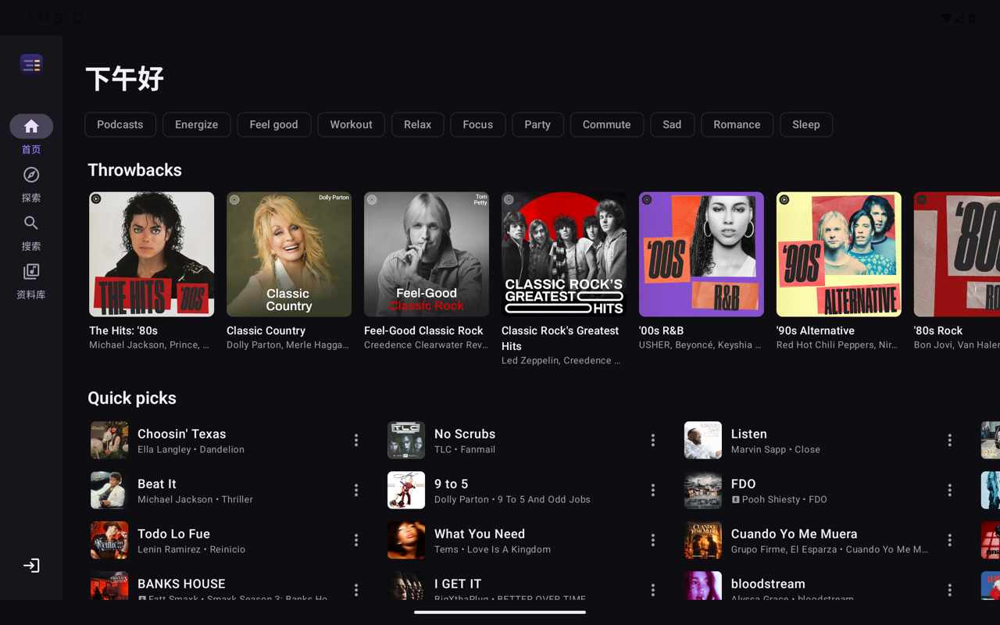
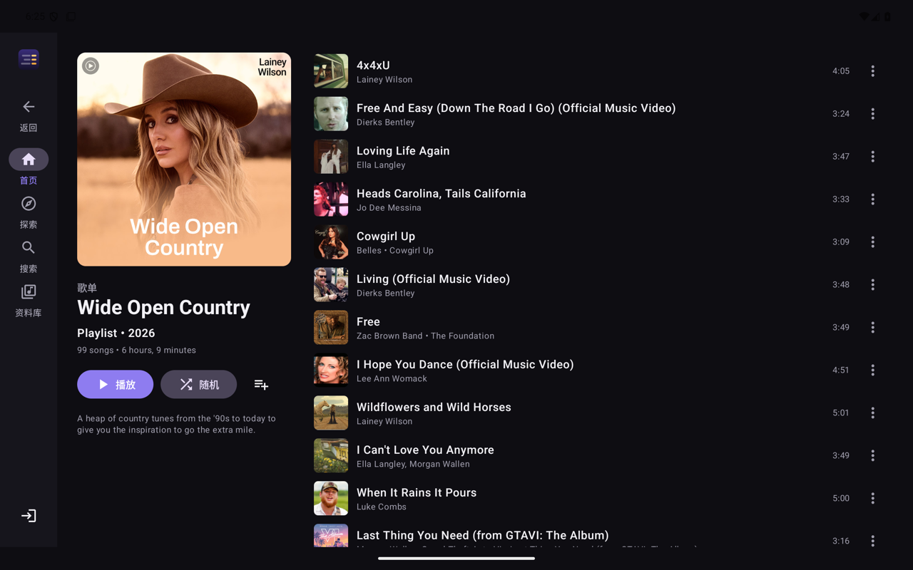
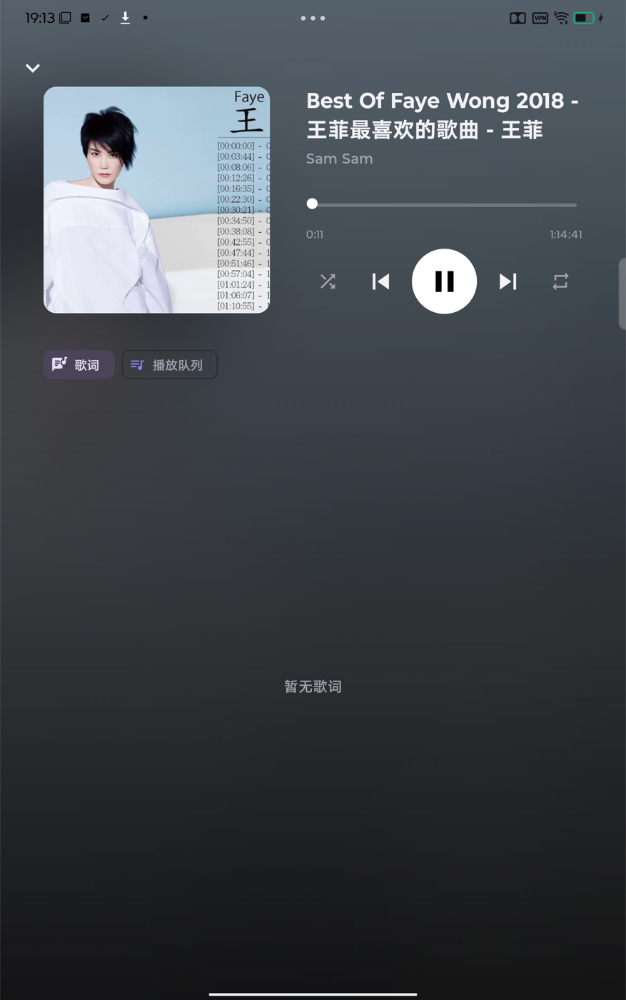
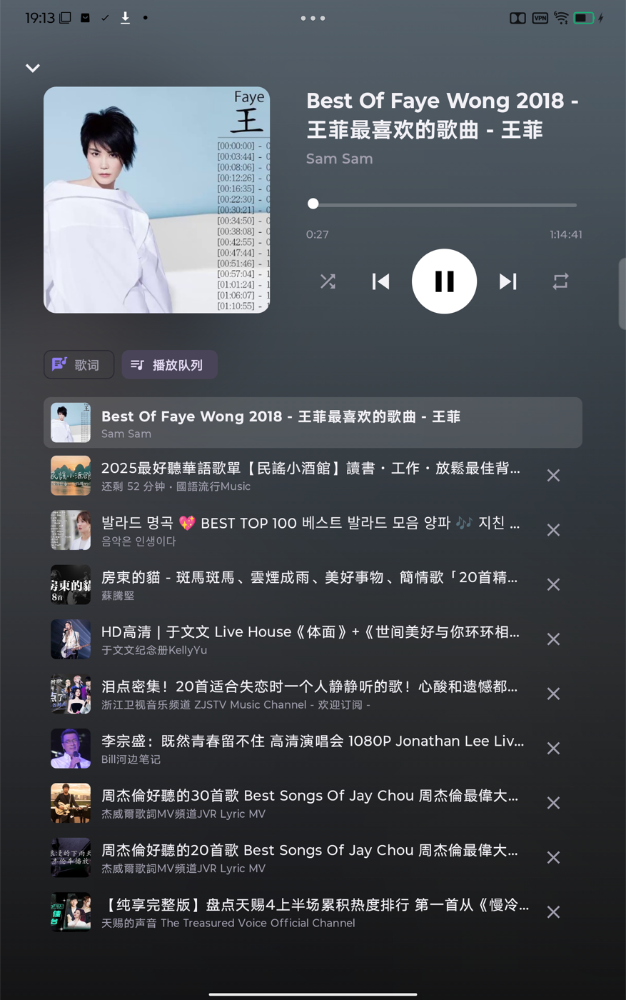
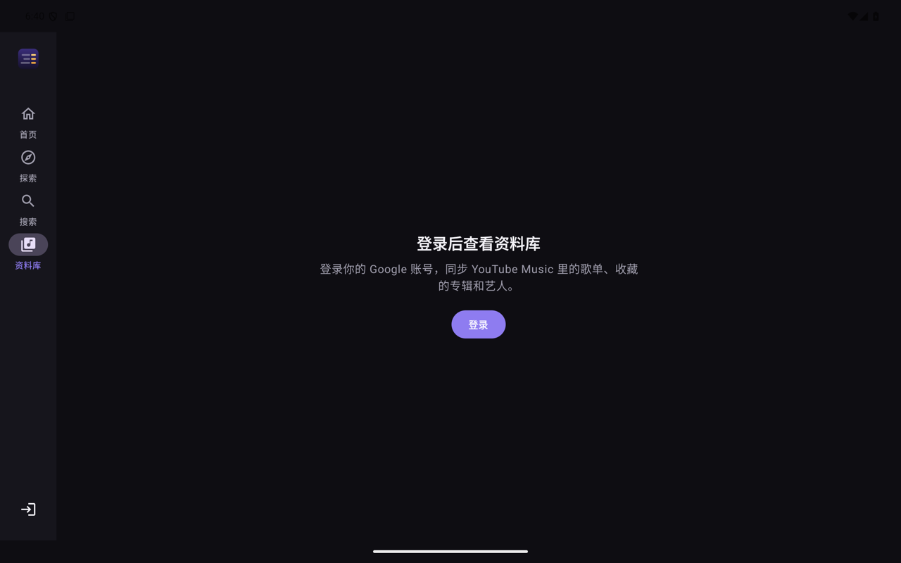

# Tarana

一个 Android 平板上的 YouTube Music 客户端。Tarana（ترانه）在波斯语和乌尔都语里是“旋律”的意思。

它是 [Radif](https://github.com/yuvrajangadsingh/radif)（macOS 上的 YouTube Music 客户端，作者 Yuvraj Angad Singh）的 Android 移植版，图标也沿用自 Radif。
原版是 Tauri（Rust + React）；这里用 Kotlin + Jetpack Compose + Media3 重写，界面按平板横屏 / 竖屏做了分栏布局。

> 非官方客户端，与 Google / YouTube 无关。

## 截图

| 首页（横屏） | 歌单（横屏） |
|---|---|
|  |  |

| 播放页（竖屏） | 播放队列（竖屏） |
|---|---|
|  |  |



## 下载

到 [Releases](../../releases/latest) 下载 APK，需要 Android 8.0 及以上。

## 功能（第一版）

- 首页（含心情筛选 chip、无限下拉）、探索（探索 / 新发行 / 排行榜 / 心情和流派）
- 搜索（联想词、历史、全部/歌曲/视频/专辑/艺人/歌单筛选）
- 专辑、艺人、歌单页（歌单分页加载）
- 后台播放：通知栏 / 锁屏 / 蓝牙耳机控制（MediaSession）
- 播放队列：单曲点播自动开电台，列表播完自动续播，下一首播放 / 加入队列 / 移除
- 全屏播放页：封面取色 + 模糊背景，同步歌词（YouTube Music → LRCLIB 回落），点歌词跳转
- 1 GB 本地音频缓存：听过的歌再播直接走磁盘
- Google 账号登录（WebView），资料库：歌单 / 专辑 / 艺人

## 与原版的对应关系

| Radif | Tarana |
|---|---|
| `src/lib/innertube/*`（WEB_REMIX InnerTube 客户端） | `yt/InnerTube.kt`、`yt/Parsers.kt`、`yt/YtMusic.kt` |
| `src/lib/lyrics/*`（YTM ANDROID_MUSIC 同步歌词、LRCLIB） | `yt/LyricsRepo.kt` |
| Rust 加密 cookie jar + Set-Cookie 回写 | `Session.kt`（应用私有存储） |
| Rust stream proxy + yt-dlp + deno | `player/StreamResolver.kt`（NewPipeExtractor）+ `player/PlaybackService.kt`（ResolvingDataSource + 缓存） |
| — | `player/ChunkedDataSource.kt`：按 `&range=` 分段下载，避免 googlevideo 对长连接限速 |

暂未移植：视频（MV）模式、刘海屏提示、Last.fm、Discord、投屏、自动更新、Musixmatch/Genius 歌词源。

## 构建与安装

```bash
./gradlew :app:assembleDebug
adb install -r app/build/outputs/apk/debug/app-debug.apk
```

连真实接口的冒烟测试（默认跳过）：

```bash
./gradlew :app:testDebugUnitTest -Plive
```

## 取流的两条通道

1. **匿名通道**（默认）：NewPipeExtractor，最高 Opus 160 kbps。
2. **回落通道**：匿名通道报“确认你不是机器人”（当前网络出口 IP 被 YouTube 限制）或失败时启用。
   直接调 InnerTube `/player`（TV 客户端 `tv_samsung` → 嵌入式播放器），登录后带 Google cookie。
   - 返回的地址是加密的，签名和 n 参数由打包在 `assets/ejs/` 的 [yt-dlp-ejs](https://github.com/yt-dlp/ejs) 求解，
     运行在一个不联网的隐藏 WebView 里（NewPipe 自带的解密已跟不上当前播放器）。
   - 播放器脚本 base.js 按版本缓存在应用私有目录。
   - 新地址开头一两秒会 403，所以交给播放器前先做预热探测；下载用 Safari UA（Chrome / TV 的 UA 会 403）。
   - 触发过一次机器人验证后，本次运行期间直接走回落通道。

## 已知问题

- 回落通道首次解析一首歌约 2～5 秒（含预热），之后有磁盘缓存。
- 网络出口 IP 被限制、又没有登录时，回落通道多半也会失败，界面会提示登录或切换网络。
- YouTube 改版导致无法播放时：匿名通道升级 NewPipeExtractor，回落通道更新 `assets/ejs/` 里的两个求解器文件
  和 `SignedInStreams.kt` 里的客户端版本号（对照 yt-dlp 的 `yt_dlp/extractor/youtube/_base.py`）。

主机上验证回落通道（需要 node，用同一份 ejs 求解器）：

```bash
./gradlew :app:testDebugUnitTest -Plive --tests '*SignedInStreamsTest*'
```

## 发布

推送 `v*` 标签后，GitHub Actions（`.github/workflows/release.yml`）会跑单元测试、打包签名后的 APK，并发布到 Release。
签名密钥放在仓库 Secrets 里（`SIGNING_KEYSTORE_BASE64`、`SIGNING_STORE_PASSWORD`、`SIGNING_KEY_ALIAS`、`SIGNING_KEY_PASSWORD`）。
没有配置这些变量时，release 包用调试密钥签名。

## 许可证

GPL-3.0（与 radif、NewPipeExtractor 一致）。打包的 yt-dlp-ejs 为 Unlicense，其依赖 meriyah（ISC）、astring（MIT）。本项目是非官方客户端。
